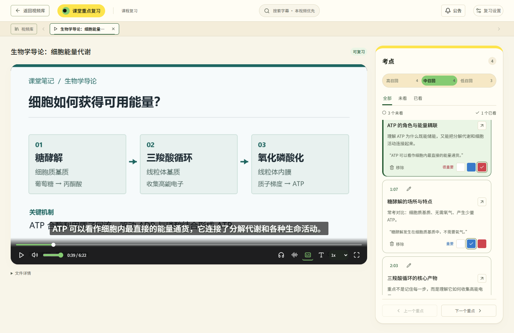
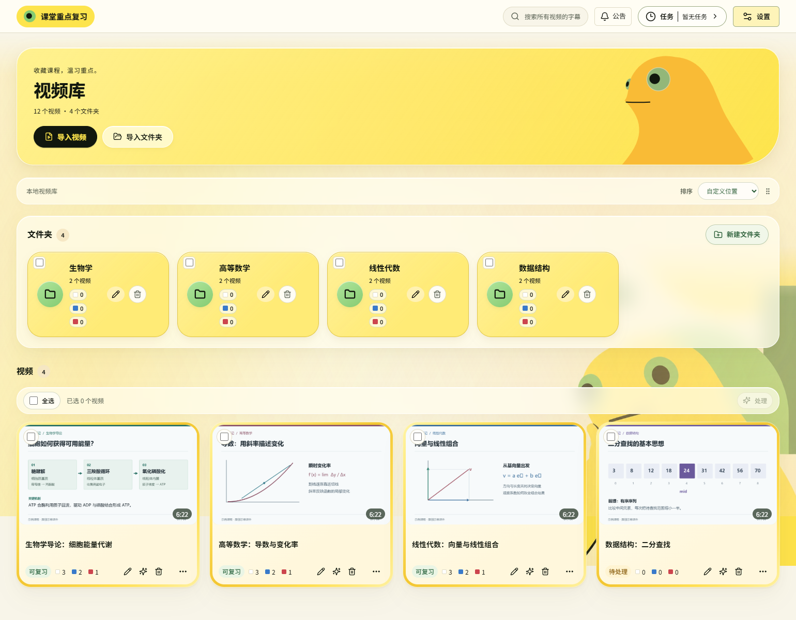
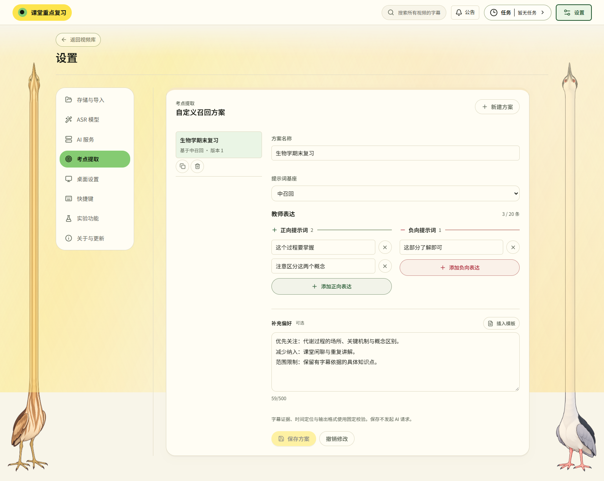
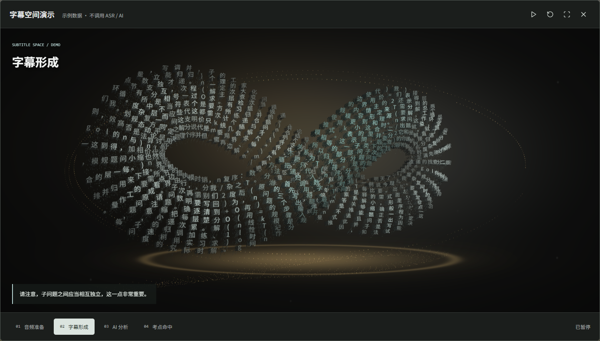

# ClassCue AI

课堂视频重点复习工具。

把长课堂视频整理成可以点击回看的复习重点。在本机生成字幕，借助 AI 筛选考点，减少反复拖动进度条、寻找老师讲解位置的时间。

适合整理课程录像、准备考试，以及复习自己有权处理的教学视频。面向 Windows 10/11 64 位系统，免费开源；AI 服务费用由所选服务商收取。

[下载软件](https://github.com/MatchaParfait/ClassCue-AI/releases/latest) · [反馈问题](https://github.com/MatchaParfait/ClassCue-AI/issues) · [MIT 许可证](LICENSE)

  

截图来自实际界面，使用示例课程与演示数据，不代表实际识别效果或处理速度。

## 能做什么

- **自动生成字幕**：在本机识别课堂视频，语音模型按需下载，不必全部安装。
- **筛选复习重点**：提供高、中、低三档召回方案，按需要多找一些重点，或只保留更明确的考点；也可以根据老师的表达习惯自定义方案。
- **点击重点直接回看**：点击考点跳到对应讲解，支持切换上下一个重点、记住播放位置和标注重要程度。
- **整理多门课程**：用文件夹管理视频库，支持批量导入、子文件夹和全库搜索。
- **处理中断后继续**：复用已有字幕和成功的 AI 处理结果，减少重复识别与请求。
- **按自己的习惯配置**：选择语音模型和 AI 服务，调整存储位置；播放时可开启实时降噪。

AI 筛选可能遗漏重点或产生误判，请结合原视频、课程大纲和教师要求复习。

## 界面一览

### 整理课程

按课程建立文件夹，集中管理课堂录像，随时找到想复习的内容。

  

### 导入并提取重点

导入视频后，选择语音模型和考点提取方案，开始处理。想多找一些重点，或只保留更明确的考点，都可以按需要选择。

  

### 按老师的习惯筛选

把“这个过程要掌握”“这部分了解即可”等常用表达加入自定义方案，让重点筛选更贴近课程。

  

## 下载与安装

1. 在 [最新版本](https://github.com/MatchaParfait/ClassCue-AI/releases/latest) 中下载 Windows 软件压缩包，不要选择 `Source code`。
2. 完整解压到独立文件夹。
3. 双击 `启动课堂重点复习.cmd`，等待首次准备完成。

首次启动和下载语音模型需要联网，请预留足够的磁盘空间。

尚无可用软件包时，请等待正式发布；仓库源码压缩包不是安装包。

## 第一次使用

1. **准备语音模型**：追求精度时，FireRed 性价比最高；追求速度时，Dolphin 性价比最高。在设置中按硬件要求选择模型，点击“下载 / 准备所选模型”。
2. **配置 AI 服务**：在设置中填写服务商提供的模型名称、API Key 和服务地址，支持 DeepSeek、GPT 及兼容服务。
3. **导入课程视频**：选择单个视频或课程文件夹，确认后开始处理，支持 `mp4`、`mov`、`mkv`、`avi`。
4. **进入重点复习**：处理完成后点击考点回看讲解，把重要内容标出来。

部分模型仅支持 GPU。

**导入会将视频移入软件的视频库**，复制并校验成功后才删除原文件。请先备份重要视频。

## 更新与公告

在“设置 → 关于与更新”中检查新版本，也可以开启自动检查。更新安装前会征求你的确认，不会静默安装或强制重启。

顶栏“公告”可以查看项目通知。新版本和新公告需要联网获取，离线仍可回看已保存的课程和考点。

## 数据与隐私

- 语音识别在本机进行，模型准备完成后可离线生成字幕。
- **AI 筛选需要联网，会把字幕片段发送给你配置的 AI 服务**，不会发送原视频和音频。
- 软件免费开源，AI 服务可能收费，具体以所选服务商为准。
- 更新和公告检查不会上传视频、字幕或 API Key。

请仅处理你有权使用的教学内容，并尊重教师、学生及其他相关人员的隐私。

## 给学习加一点趣味性

等待课程处理时，也可以看看文字在空间里流动、聚合。字幕空间用立体文字呈现字幕与考点的形成过程，让学习多一点趣味。

这是一个可选的实验功能，默认关闭。在“设置 → 实验功能”中即可观看演示或开启。

  

AI 分析阶段还可以选择不同的动画主题：

| 奶龙 | GPT | 大肥鱼 |
| :---: | :---: | :---: |
|  |  |  |

以上为内置示例演示。切换的是动画主题，不影响考点提取。

## 反馈与建议

欢迎在 [Issues](https://github.com/MatchaParfait/ClassCue-AI/issues) 提出建议或反馈使用问题。请勿公开 API Key、私人字幕、课堂录像及其他个人信息。

## 许可证

本项目采用 [MIT License](LICENSE)。随软件提供的模型与第三方资源保留各自许可证。
